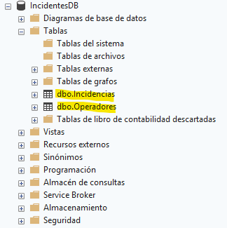
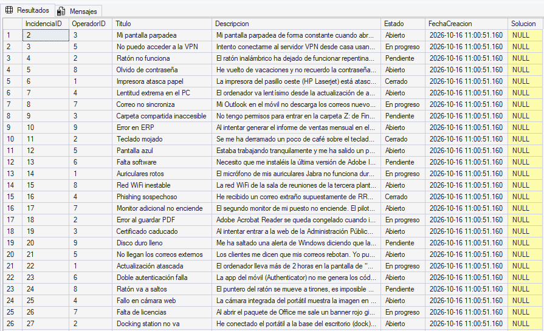
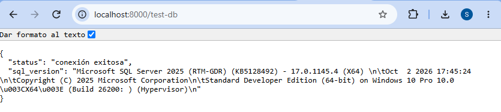

# Memoria del Proyecto DP-800: Aplicación de Gestión de Incidencias
**Autora:** Sara Antón Madero

## Fase 1: Configuración inicial y Diseño Relacional

### 1.1. Inicialización del Entorno y Control de Versiones
Se ha creado la estructura de directorios en local separando la lógica del proyecto en tres bloques principales: aplicación (`app`), base de datos (`database`) y documentación (`docs`). 

Para el control de versiones, se ha inicializado Git y se ha vinculado a un repositorio remoto en GitHub.

```bash
mkdir app database docs
git init
git remote add origin https://github.com/SaraAM06/DP-800-Project.git
git add .
git commit -m "Inicialización del proyecto y estructura de carpetas"
git push -u origin main
```
> *(Inserta aquí la captura de tu repositorio de GitHub)*
> *(Opcional: Inserta aquí la captura de la consola resolviendo el merge con Vim)*

### 1.2. Diseño de la Base de Datos Relacional
La base de datos se ha montado sobre SQL Server 2025 utilizando SQL Server Management Studio (SSMS). Se ha creado el esquema inicial `IncidentesDB` con dos tablas principales relacionadas por una clave foránea (`OperadorID`):

```sql
CREATE DATABASE IncidentesDB;
GO
USE IncidentesDB;
GO

CREATE TABLE Operadores (
    OperadorID INT IDENTITY(1,1) PRIMARY KEY,
    Nombre NVARCHAR(100) NOT NULL,
    Email NVARCHAR(100) UNIQUE NOT NULL
);

CREATE TABLE Incidencias (
    IncidenciaID INT IDENTITY(1,1) PRIMARY KEY,
    OperadorID INT FOREIGN KEY REFERENCES Operadores(OperadorID),
    Titulo NVARCHAR(200) NOT NULL,
    Descripcion NVARCHAR(MAX) NOT NULL,
    Estado NVARCHAR(50) DEFAULT 'Abierta',
    FechaCreacion DATETIME DEFAULT GETDATE(),
    Solucion NVARCHAR(MAX)
);
```


### 1.3. Generación de Datos de Prueba (Mock Data)
Para preparar la futura búsqueda semántica, se ha utilizado Inteligencia Artificial generativa para poblar la base de datos con registros que simulan incidencias de soporte técnico reales, utilizando lenguaje natural variado. 

Primero se insertaron los registros en la tabla `Operadores` para respetar la integridad referencial y evitar conflictos de clave foránea, y posteriormente se insertaron las incidencias.

**Ejemplo de inserción generada:**
```sql
INSERT INTO Incidencias (OperadorID, Titulo, Descripcion, Estado) VALUES 
(3, 'Mi pantalla parpadea', 'Mi pantalla parpadea de forma constante cuando abro Excel o cualquier programa de Office, me marea bastante.', 'Abierto');
```


### 1.4. Conexión entre la Aplicación y la Base de Datos
Para establecer la comunicación entre el backend y SQL Server, se instalaron las dependencias necesarias (`fastapi`, `uvicorn`, `pyodbc`). Se desarrolló un *endpoint* de prueba en el archivo `app/main.py`.

**Código de app/main.py:**
```python
import pyodbc
from fastapi import FastAPI

app = FastAPI(title="API Gestión de Incidencias DP-800")

SERVER = 'TU_SERVIDOR' # Configurado según la instancia local
DATABASE = 'IncidentesDB'
DRIVER = '{ODBC Driver 17 for SQL Server}' 

def get_db_connection():
    conn = pyodbc.connect(f'DRIVER={DRIVER};SERVER={SERVER};DATABASE={DATABASE};Trusted_Connection=yes;')
    return conn

@app.get("/test-db")
def test_connection():
    try:
        conn = get_db_connection()
        cursor = conn.cursor()
        cursor.execute("SELECT @@VERSION")
        row = cursor.fetchone()
        conn.close()
        return {"status": "conexión exitosa", "sql_version": row[0]}
    except Exception as e:
        return {"status": "error", "message": str(e)}
```

**Resolución de incidencias de acceso:**
Durante la primera prueba, la API devolvió el error `18456` debido a que el usuario de Windows no tenía permisos de acceso a la base de datos. Esto se solucionó desde SQL Server Management Studio, creando un "Nuevo inicio de sesión" para el usuario y otorgándole el rol de servidor `sysadmin`.

Tras aplicar este ajuste y ejecutar el servidor web de FastAPI (`python -m uvicorn main:app --reload`), la prueba de conexión devolvió un estado exitoso y la versión correcta de SQL Server.




